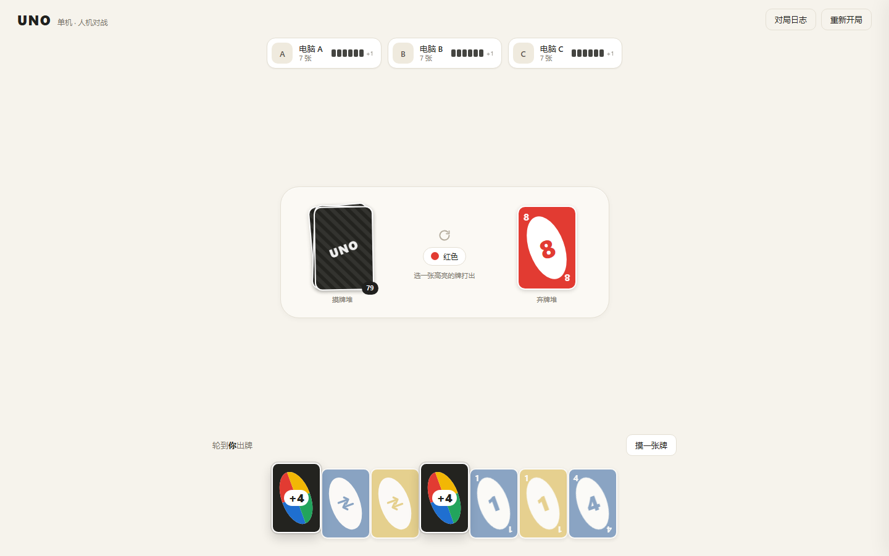
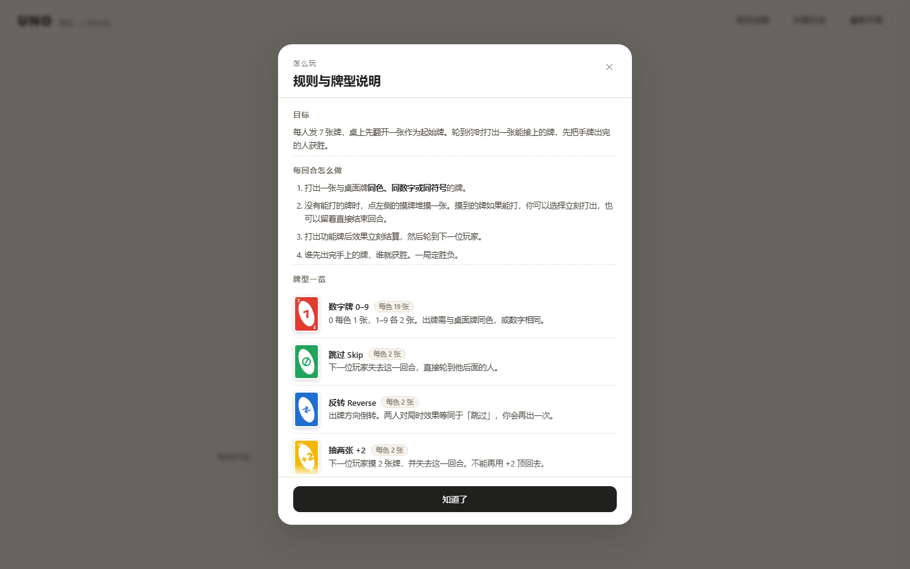
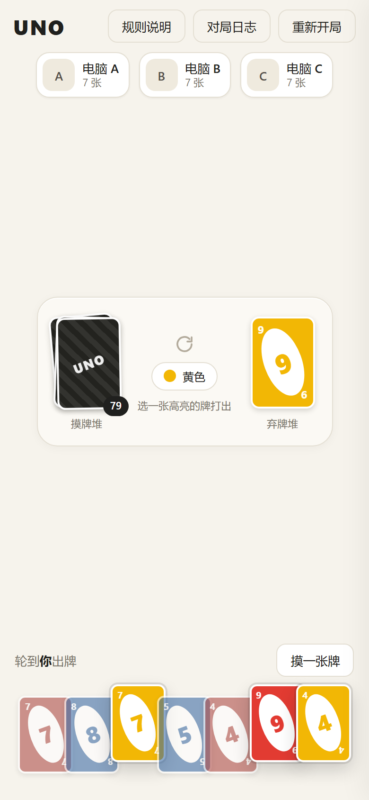
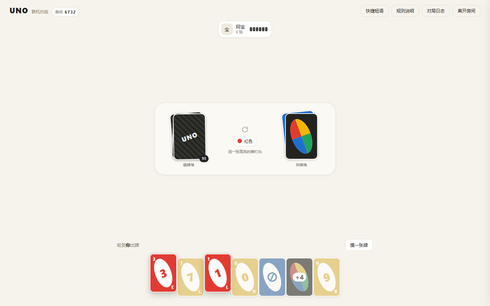

# UNO · 网页版四人小游戏

一个基于原生 HTML / CSS / JavaScript 实现的 UNO 游戏，支持**单人对抗 AI**与**房间码在线联机**（2–4 人）。

## 功能

- **单机人机对战**：2–4 人牌桌，AI 分简单 / 普通 / 困难三档
- **规则说明面板**：内置规则与牌型图解，卡面直接复用游戏渲染器，新手不用先看文档
- **房间码联机**：4 位房间码创建与加入，2–4 人实时对战，服务端裁决每一步
- **断线重连**：掉线后座位保留 30 秒，刷新页面自动回到原局；超时由系统托管继续打
- **房主管理**：开始游戏、移出玩家、结束后再来一局
- **快捷短语**：一键发送常用短语，同房间所有人可见
- **响应式布局**：桌面与手机均可正常游玩

## 界面预览



游戏内随时可调出规则与牌型说明，卡面图解直接复用游戏渲染器：



手机端：



联机等待室与对战：




## 规则说明

采用精简版 108 张牌组，规则细节见 [docs/rules.md](docs/rules.md)。

保留的牌型：

| 牌型 | 数量 | 效果 |
| --- | --- | --- |
| 数字牌 0–9 | 76 | 无特殊效果，按颜色或数字接牌 |
| 跳过 Skip | 8 | 下一家失去回合 |
| 反转 Reverse | 8 | 出牌方向反向（两人对局时等同于再出一次） |
| 抽两张 +2 | 8 | 下一家摸 2 张并停一轮 |
| 变色 Wild | 4 | 指定接下来的颜色 |
| 变色 +4 | 4 | 指定颜色，下一家摸 4 张并停一轮 |

为保证规则清晰、避免判定争议，**未采用**以下变体：换手牌、洗牌重发、自定规则牌、叠牌连锁（+2 叠 +2）、7-0 换牌、质疑 +4。

胜负：一局定胜负，先出完手牌者获胜。不计分、无 UNO 喊话罚牌、无出牌倒计时。

## 联机怎么玩

1. 首页把「玩法」切到 **联机对战**，填写昵称。
2. 一人点 **创建房间**，拿到 4 位房间码（例如 `6732`）。
3. 其他人输入房间码加入，最多 4 人。
4. 房主点 **开始游戏**，各自在自己的设备上出牌。

规则要点：

- **服务端是唯一裁判**。客户端只发送「我想出这张牌」，是否合法由服务端用 `shared/rules.js` 判定后广播，改前端也作弊不了。
- **看不到别人的牌**。服务端下发的状态里，其他人的手牌只有张数，摸牌堆只有剩余数量，随机种子不下发。
- **掉线有 30 秒缓冲**。刷新页面或网络闪断后会自动凭令牌回到原座位，手牌原样保留；30 秒没回来则由系统托管替你出牌，其他人不会被卡住。
- **房主可以在等待室移出玩家**，对局结束后可以再来一局（其他人在原座位继续）。

## 项目结构

```
web_game/
├─ shared/          前后端共用（纯函数，可在 Node 与浏览器直接运行）
│  ├─ constants.js  牌型、颜色、牌组规格
│  ├─ deck.js       108 张牌组、洗牌、发牌
│  ├─ rules.js      出牌判定与回合状态机
│  ├─ ai.js         三级 AI 决策（单机对手 + 服务端托管共用）
│  └─ view.js       把完整状态投影成每个玩家各自的视野
├─ client/          浏览器端
│  ├─ index.html
│  ├─ css/style.css
│  └─ js/
│     ├─ main.js        入口：模式切换、弹窗、快捷键
│     ├─ net.js         WebSocket 封装（自动重连 + 发送队列）
│     ├─ game/local.js  单机控制器
│     ├─ game/online.js 联机会话（只发意图，不收发状态计算）
│     └─ ui/            卡牌、牌桌渲染、等待室、规则面板
├─ server/
│  ├─ index.js      静态站点 + WebSocket，同端口
│  ├─ ws.js         最小 RFC6455 实现（零依赖）
│  └─ rooms.js      房间、席位、房主权限、断线保留与托管
├─ tests/           规则引擎、房间逻辑、真实 WebSocket 端到端测试
└─ docs/            规则文档与截图
```

规则引擎与视图投影被前后端共同引用，因此单机与联机使用完全一致的判定逻辑，不存在“我这边显示能出、服务器说不行”的分裂。

## 本地运行

```bash
npm start
```

浏览器打开 `http://localhost:3000` 即可。**无需 `npm install`**，项目零运行时依赖。

和朋友在同一 WiFi 下玩：把 `localhost` 换成你电脑的局域网 IP（`ipconfig` 查看，形如 `192.168.1.5:3000`），对方用这个地址打开即可。Windows 首次可能会弹出防火墙提示，选择允许。

## 开发进度

- [x] 初始化仓库
- [x] 牌组构建与洗牌
- [x] 出牌合法性判定与回合状态机
- [x] 界面渲染与交互
- [x] 三级 AI
- [x] 规则与牌型说明面板
- [x] WebSocket 房间与联机对战
- [x] 断线重连、托管、房主管理、快捷短语
- [ ] 移动端适配收尾与公网部署指南
